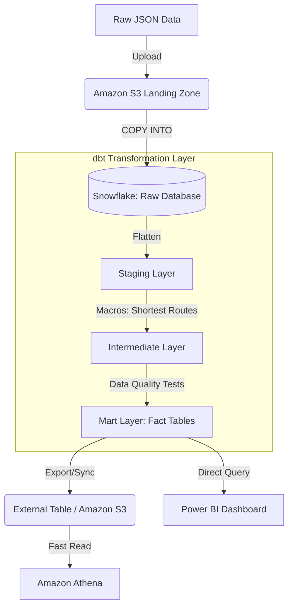

# Top 30 Busiest Airports Data Pipeline ✈️

## Project Overview
This Data Engineering project builds an end-to-end ELT (Extract, Load, Transform) pipeline to process, flatten, and analyze data regarding the Top 30 Busiest Airports in the world. The pipeline ingests raw JSON data from Amazon S3 into Snowflake, transforms it using dbt, and serves it for high-performance querying in Amazon Athena and dashboarding in Power BI.

## Architecture Diagram



## Data Pipeline Workflow

### 1. Ingestion (Extract & Load)
* **Source:** Airport data is generated or received in `JSON` format.
* **Storage:** The raw JSON files are uploaded to an **Amazon S3** bucket.
* **Loading:** Snowflake's `COPY INTO` command is utilized to efficiently load the semi-structured JSON data from S3 into a raw Snowflake table.

### 2. Transformation (dbt)
The transformation logic is orchestrated using **dbt (Data Build Tool)**, following best practices for modular data modeling:
* **Staging (`stg`):** The semi-structured JSON payloads are flattened into standard tabular formats.
* **Intermediate (`int`):** Business logic is applied here. A custom **dbt macro** was created to calculate and identify the *shortest routes* between specific airport hubs.
* **Mart (`fct` / `dim`):** Final aggregated **Fact Tables** are generated, containing the clean, analysis-ready data for the top 30 airports.
* **Testing:** Automated dbt tests (`unique`, `not_null`, and custom data tests) are enforced on the models to ensure data integrity before it reaches production.

### 3. Serving & Analytics (Downstream)
* **Amazon Athena:** Data from the final mart layer is pushed to an External Table (backed by S3) to allow rapid, ad-hoc querying via Amazon Athena without hitting the Snowflake compute warehouse.
* **Power BI:** The final Fact Table in Snowflake is connected to Power BI to power interactive dashboards and visual analytics.

## Tech Stack
* **Cloud Storage:** Amazon S3
* **Data Warehouse:** Snowflake
* **Data Transformation:** dbt (Data Build Tool)
* **Ad-Hoc Querying:** Amazon Athena
* **Business Intelligence:** Power BI

## Repository Structure
```text
├── dbt_project/
│   ├── macros/             # Contains the shortest route calculation macro
│   ├── models/
│   │   ├── staging/        # JSON flattening models
│   │   ├── intermediate/   # Business logic models
│   │   └── marts/          # Final Fact tables for Power BI
│   ├── tests/              # Custom dbt data tests
│   └── dbt_project.yml
├── .github/workflows/      # CI/CD pipeline configurations
└── README.md
```